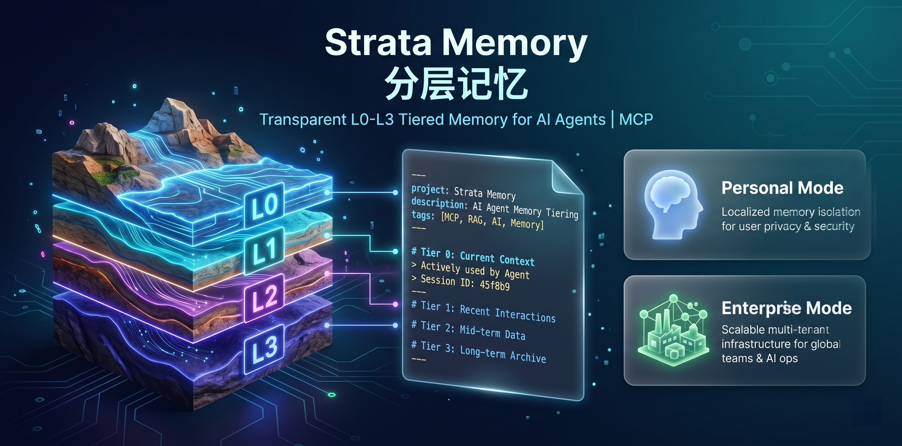

# Strata Memory 2.0（分层记忆 · 工业级 AI 记忆基座）

<p align="center">
  <a href="./assets/brand/README.md">
    <picture>
      <source media="(prefers-color-scheme: dark)" srcset="./assets/brand/extensions/lockup_dark_transparent.svg">
      
    </picture>
  </a>
</p>

<p align="center">
  
</p>

标志文件（Agensi 用 512 召回点图标、无点 favicon、横版 lockup、wordmark）见 [assets/brand/](assets/brand/README.md)。

[](LICENSE)
[](https://modelcontextprotocol.org)

**大模型只做决策，确定性代码接管一切。**

Strata Memory 2.0 是面向 Multi-Agent 的 **MCP 记忆中枢**：以 **SQLite 为唯一真相源（SoT）**，向量库可一键重建，Markdown 仅为只读投影。写入经过 Quality Kernel / CBT 中间件；召回采用渐进式漏斗，避免上下文爆炸。

---

## 核心设计

| 层 | 角色 | 可摧毁？ |
|----|------|----------|
| **SQLite Truth Store** | 权威数据（记忆 / 审计 / 轨迹） | 否（备份） |
| **Chroma + BGE-M3** | 语义索引伴生层 | **是** — `strata_rebuild_index` |
| **Markdown projection** | 人类可读视图 | **是** — `strata_project` 再生 |

- **L0–L3 分层** + 类型化 TTL（事实/偏好/规程/情节）
- **三维隔离**：`tenant_id` + `user_id` + `session_id`
- **Scratch → Durable**：会话暂存，确认后 `promote_session`
- **防御性 MCP 契约**：工具描述强制「作用 / 触发 / 禁忌」

## 快速开始

`strata-memory-mcp` 还没有发布到 PyPI，不要使用 `uvx strata-memory-mcp`。从本仓库安装（需要 Python 3.11+、`uv`、`git`）：

```bash
git clone https://github.com/SherryLi-vc/strata-memory.git
cd strata-memory
uv sync
export STRATA_PALACE="${STRATA_PALACE:-$HOME/.strata/palace}"
uv run strata-memory-mcp
```

在你自己的 shell 配置里设置嵌入密钥（`STRATA_EMBEDDING_API_KEY` 或 `STRATA_API_KEY`）。不要把 key 贴进对话、写进仓库，或写成带 `...` 的脱敏占位符。云端密钥解析顺序：显式参数 → `STRATA_EMBEDDING_API_KEY` → `STRATA_API_KEY` → 对应提供方的 `SILICONFLOW_API_KEY` 或 `OPENAI_API_KEY`。

**嵌入（可配置，默认 SiliconFlow）：**

| 变量 | 作用 | 默认 |
|------|------|------|
| `STRATA_EMBEDDING_PROVIDER` | `siliconflow`、`openai`、`openai_compatible`、`local` | `siliconflow` |
| `STRATA_EMBEDDING_BASE_URL` | OpenAI 兼容 `POST /embeddings` 根地址 | SiliconFlow 为 `https://api.siliconflow.cn/v1` |
| `STRATA_EMBEDDING_MODEL` | 模型 id | SiliconFlow 为 `BAAI/bge-m3` |
| `STRATA_EMBEDDING_DIMENSION` | 入库向量维度 | `384`（bge-m3 截断；OpenAI `text-embedding-3-small` 为 1536） |

- **SiliconFlow** 是默认选项，不是唯一选项。模型 `BAAI/bge-m3` 返回 1024 维，客户端保留前 `STRATA_EMBEDDING_DIMENSION` 维。
- **任意 OpenAI 兼容端点**（OpenAI、自建网关、Ollama、llama.cpp、TEI、vLLM）：`STRATA_EMBEDDING_PROVIDER=openai_compatible`，并设置 `STRATA_EMBEDDING_BASE_URL` 和 `STRATA_EMBEDDING_MODEL`。向量长度必须等于 `STRATA_EMBEDDING_DIMENSION`，否则请改维度后 `strata_rebuild_index(confirm=true)`。本机回环地址（`localhost` / `127.0.0.1`）不要求 API key。
- **本机进程内模型：** `STRATA_EMBEDDING_PROVIDER=local`，然后 `uv sync --extra local`。默认模型 `sentence-transformers/all-MiniLM-L6-v2`（384 维）。文本不会发到嵌入 API。

**网络：** 只要提供方不是 `local`，配置的嵌入端点就会收到记忆正文和召回查询。SQLite 真相源留在本机 `STRATA_PALACE`（默认 `~/.strata/palace`）。换模型或维度后需要重建向量索引。

### 宿主配置

模板在 [`skills/strata-memory/references/`](skills/strata-memory/references/)。只改路径；密钥由用户在本机填写，对话里不要出现 key。

| 宿主 | 配置位置 | 模板 |
|------|----------|------|
| Claude Code | 项目 `.mcp.json`，或 `~/.claude.json` 的 `mcpServers` | `references/claude-code.mcp.json`（`${STRATA_API_KEY}` 由 Claude Code 从环境展开） |
| Cursor | `~/.cursor/mcp.json` 或项目 `.cursor/mcp.json` | `references/cursor-mcp.json` |
| Claude Desktop | Settings → Developer → Edit Config。macOS：`~/Library/Application Support/Claude/claude_desktop_config.json`；Windows：`%APPDATA%\Claude\claude_desktop_config.json` | `references/claude-desktop.json` |
| Hermes | `~/.hermes/config.yaml` 的 `mcp_servers`；key 与 `STRATA_DIR` 写在 `~/.hermes/.env` | `references/hermes-config.yaml` |

Hermes 启动器是 [`examples/strata-wrapper.sh`](examples/strata-wrapper.sh)。把脚本拷到 `~/.hermes/scripts/` 并 `chmod +x`。`STRATA_DIR` 必须指向你的克隆（环境变量或 `~/.hermes/.env`）；脚本不再默认作者本机目录。改完后 `/reload-mcp` 或重启会话。

[examples/cursor-mcp.json](examples/cursor-mcp.json) 与 [examples/hermes-config.yaml](examples/hermes-config.yaml) 和 skill 模板一致，以 skill 目录里的文件为准。

### Agent Skill

[`skills/strata-memory/SKILL.md`](skills/strata-memory/SKILL.md) 是 Claude Code、Cursor、Claude Desktop、Hermes 共用的操作规程。frontmatter `name` 与目录名都是 `strata-memory`。

克隆本仓库后：

- Claude Code 和 Cursor 从 `.claude/skills/strata-memory` 加载
- Hermes 从 `.hermes/skills/strata-memory` 加载；在仓库里先执行一次 `hermes skills trust`
- Claude Desktop 不扫描 git 仓库。MCP 用上表接入；需要这段规程时，把 `skills/strata-memory` 打成 zip（顶层是 `strata-memory/SKILL.md`）再在应用里上传

给其他项目全局使用时，把该目录复制到 `~/.claude/skills/strata-memory`、`~/.cursor/skills/strata-memory` 或 `~/.hermes/skills/strata-memory`。

Agensi 打包同一目录：

```bash
cd skills && zip -r ../strata-memory-agensi.zip strata-memory -x '*.DS_Store'
```

## MCP 工具（11 个，意图聚合）

| Tool | 意图 |
|------|------|
| `strata_init` | 初始化 SoT + 配置 |
| `commit_memory` | 经 Quality Kernel 写入事实 |
| `promote_session` | Scratch → Durable |
| `recall_context` | 渐进召回（id + 摘要 + 分数） |
| `expand_memory_detail` | 按 id 二次展开全文 |
| `strata_doctor` | SoT ↔ 索引一致性巡检 |
| `strata_rebuild_index` | 从 SQLite 全量重建向量（`confirm=true`） |
| `strata_stats` | L0–L3 Token 水位线 |
| `strata_project` | 导出只读 Markdown 投影 |
| `strata_digest` | 后台降级 / 归档（TTL + 分数） |
| `strata_hygiene` | 过期/重复/secret 卫生扫描与可选修复 |

### 写入示例

```json
{
  "user_id": "user_001",
  "memory_type": "user_preference",
  "fact_claim": "User prefers dark mode in VS Code with Monokai Pro theme.",
  "confidence_score": 0.92,
  "session_id": "sess_2026-08-04"
}
```

### 召回示例

```json
{
  "user_id": "user_001",
  "query": "IDE theme preferences",
  "context_depth": "deep",
  "limit": 8
}
```

返回仅为卡片列表；需要细节时：

```json
{ "user_id": "user_001", "memory_id": "<id from hits>" }
```

## 禁忌（Quality Kernel 硬拦截）

- 密码 / API Key / Token
- 纯情绪发泄、无事实
- 模糊时间（刚才 / 昨天 / today）— 改用 ISO 日期
- 将「也许 / 可能 / probably」写成 `factual_truth`

## 架构一览

```
LLM ─commit_memory─► Quality Kernel ─► CBT Middleware ─► SQLite (SoT)
                                                    └─► Chroma (rebuildable)

LLM ─recall_context─► Hybrid RRF (vector + FTS5) ─► {id, summary, score}
LLM ─expand_memory_detail(id)─► detail (scope-checked)
```

完整说明：[docs/architecture.md](docs/architecture.md) · 工具契约：[docs/tools.md](docs/tools.md)

## 从 0.2.x 迁移

| 0.2.x | 2.0 |
|-------|-----|
| `memorize` | `commit_memory` |
| `wake_up` / `search` | `recall_context` + `expand_memory_detail` |
| `get_health` | `strata_stats` / `strata_doctor` |
| Markdown 直写 | SQLite SoT；Markdown 仅投影 |

**批量灌入旧 drawer（不删源文件）：**

```bash
# 预览
uv run python -m strata_memory.cli migrate --palace ~/.strata/palace

# 写入 SQLite
uv run python -m strata_memory.cli migrate --palace ~/.strata/palace --apply

# 写入 + 重建向量索引（密钥已在环境中，不要写进命令）
uv run strata-memory-migrate --palace ~/.strata/palace --apply --rebuild-vectors
```

完整说明：[docs/migration-v02.md](docs/migration-v02.md) · [CHANGELOG.md](CHANGELOG.md)

## 安全

- 记忆存在本地 `STRATA_PALACE`。非 `local` 提供方会把记忆正文和召回查询发到配置的嵌入端点（默认 SiliconFlow `https://api.siliconflow.cn/v1`）
- 密钥只走环境变量（`STRATA_EMBEDDING_API_KEY` / `STRATA_API_KEY`），不写入 `config.json`，也不要贴进对话
- 写操作无裸 CRUD；破坏性重建必须 `confirm=true`
- 跨 `user_id` / `tenant_id` 的 expand 硬失败

见 [SECURITY.md](SECURITY.md)。

## 开发

```bash
uv sync --extra dev
uv run pytest -v
uv run strata-memory-mcp
```

## License

MIT — 见 [LICENSE](LICENSE)
